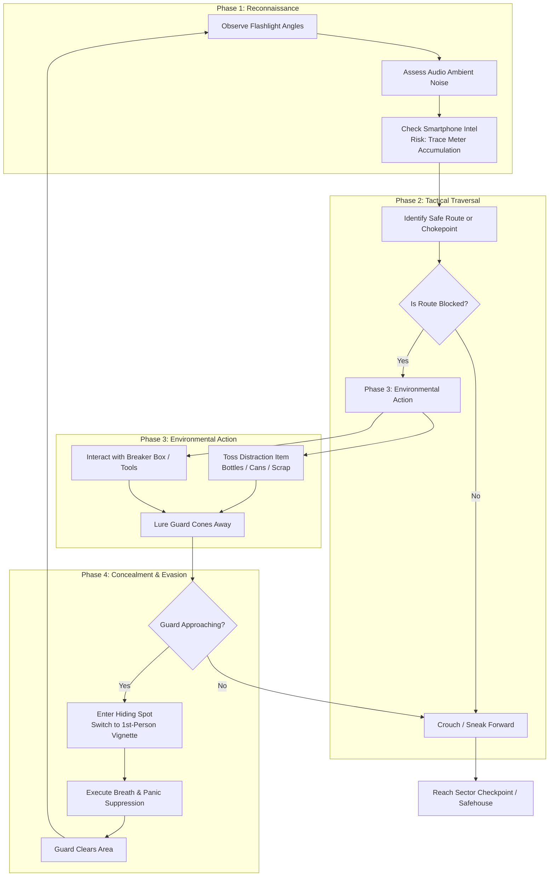

# Core Loop
> [!info] Guideline
> Map the primary cyclical sequence of gameplay actions, rewards, and progression steps. What does the player do repeatedly every 2 to 5 minutes?
> > [!tip] You can create your flowcharts using [mermaid](https://mermaid.js.org/) or [draw.io](https://draw.io) as they are compatible within Obsidian. (draw.io requires a community plugin)

### Detailed Loop Breakdown
1. **[[Reconnaissance]]:** The player assesses guard routes, sweeping flashlight arcs, and ambient sound surfaces. Players may briefly consult their smartphone for map coordinates, incurring [[Mechanics_Deep_Dive#2-digital-risk-smartphone-trace-system|Digital Risk]].
2. **[[Exploration]]:** Traversing claustrophobic alley corridors, shanty overhangs, and drainage pipes while scavenging single-use bypass gear.
3. **[[Distraction]]:** Utilizing physics debris or electrical switches to force patrol units away from critical chokepoints.
4. **[[Active Hiding]]:** Slipping into drums, alcoves, or beneath tarps when line of sight is broken, transitioning to an immersive first-person viewpoint where physiological panic must be actively mitigated.

# Controls & [[Player Actions]]
> [!info] Guideline
> Map system inputs to specific in-game actions, output behavior, and operational constraints.
> > [!tip] Attach an image of the controller you wish to use with the actions mapped out.

- **Camera View:** 2D Top-Down perspective during movement and navigation; switches dynamically to an immersive, claustrophobic 1st-Person Vignette during Active Hiding states.
- **Movement Profile:** Precise multi-directional grid/free 8-way movement; distinct noise footprint contrast between crouching/slow walking and sprinting.

| Input               | Action                      | Context / Notes                                                                                                  |
| ------------------- | --------------------------- | ---------------------------------------------------------------------------------------------------------------- |
| `W / A / S / D`     | [[Movement]]                | Standard walking speed; minimal sound emission radius.                                                           |
| `Left Shift`        | [[Sprint]]                  | Increases traversal speed by 80%; expends stamina and dramatically increases audio footprint.                    |
| `E`                 | [[Interact]]                | Operates doors, gathers collectible documents, throws switches, and Enters/Exits hiding spots.                   |
| `Right Click` / `F` | [[Aim & Throw Distraction]] | Displays targeted trajectory arc to toss scavenged debris (bottles, stones, scrap).                              |
| `Space` (Hold)      | [[Breath Suppression]]      | Active during Hiding state; stops protagonist's heavy breathing while slowly building the Panic meter.           |
| `Tab`               | [[Toggle Smartphone]]       | Opens digital map and intercepted radio feeds; continuously raises the enemy Digital Trace Level while deployed. |
## Game Rules & Logic
> [!info] Guideline
> Define the operational boundary rules, victory/defeat criteria, and state-persistence systems governing the game session.
- **Win Condition:** Safely traverse all urban sectors (Alleyways, Commercial Market, Drainage Canal, Safehouse Perimeter) without full apprehension, delivering intact evidence to the resistance safehouse.
- **Fail Condition:**
  1. Caught within the capture perimeter of a militarized police officer.
  2. Sustaining direct line of sight in open light without cover for longer than the detection grace timer.
  3. Failure of the Breath Suppression minigame while an investigator searches the immediate hiding radius.
- **Failure Penalty:** Session reloads at the most recent Sector Safe Zone / Infiltration Checkpoint. Run statistics penalize "Times Spotted" and calculate lower end-of-run stealth ratings.
- **Save & Persistence System:** Segment-based automatic checkpointing when transitioning major sector gates. System preserves collected documents, unlocked shortcut gates, and unlocked branch paths into the profile save file.
